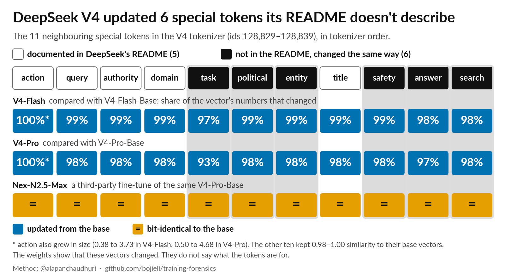
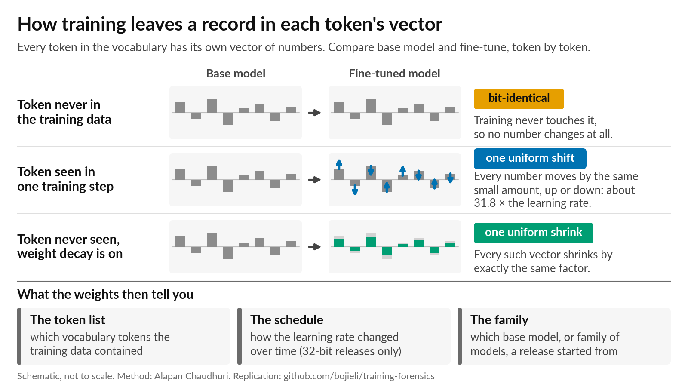
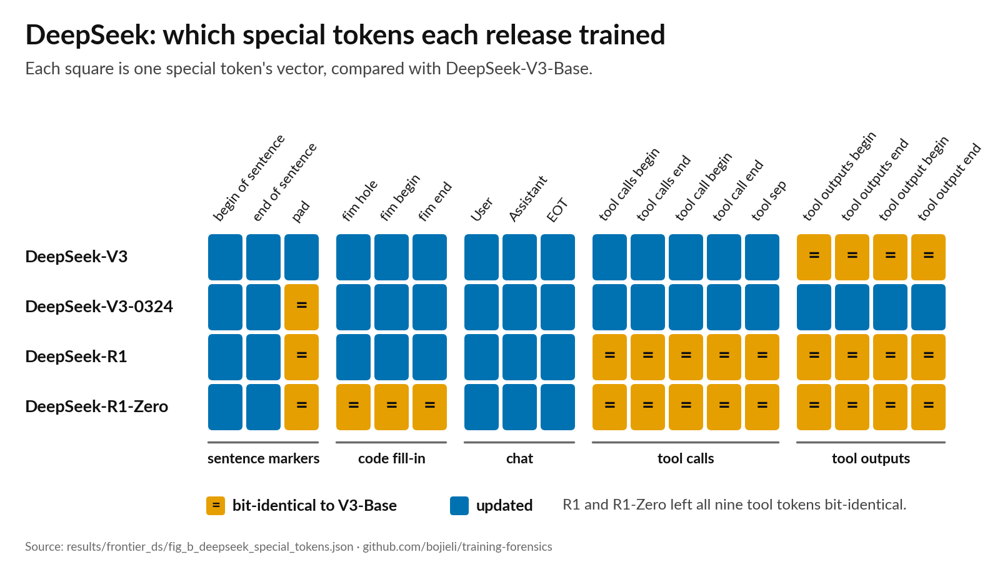
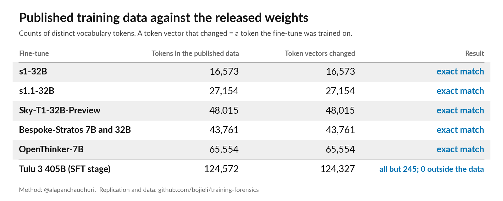
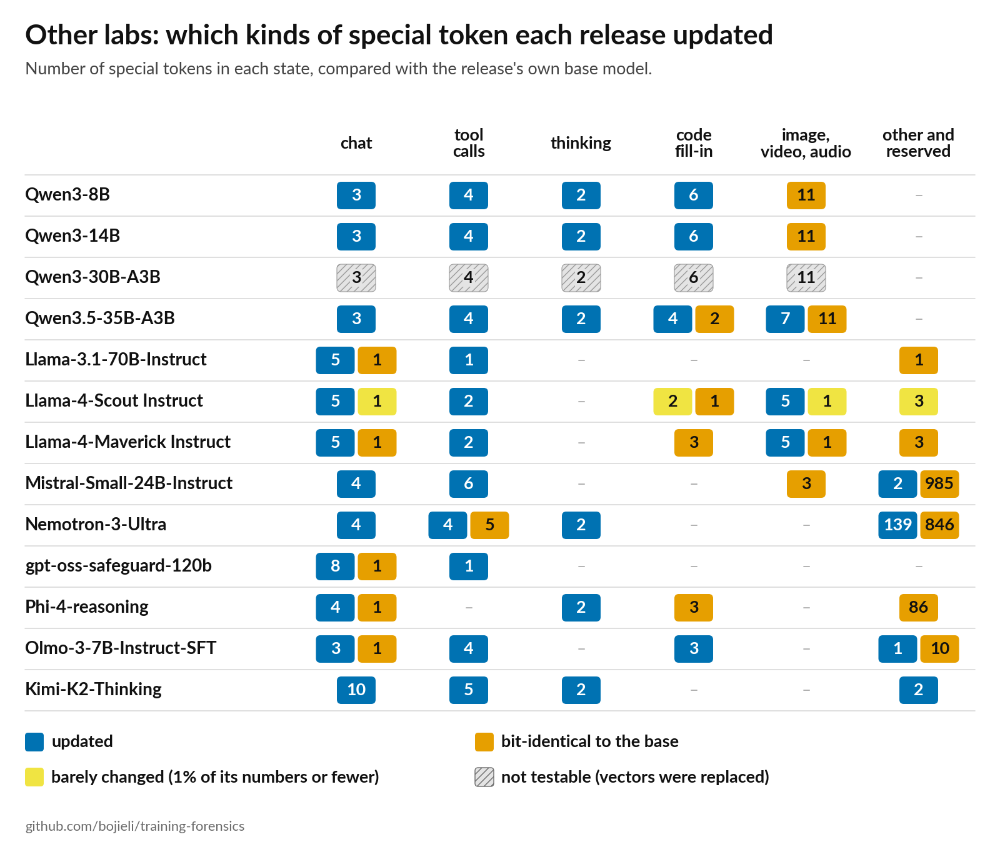
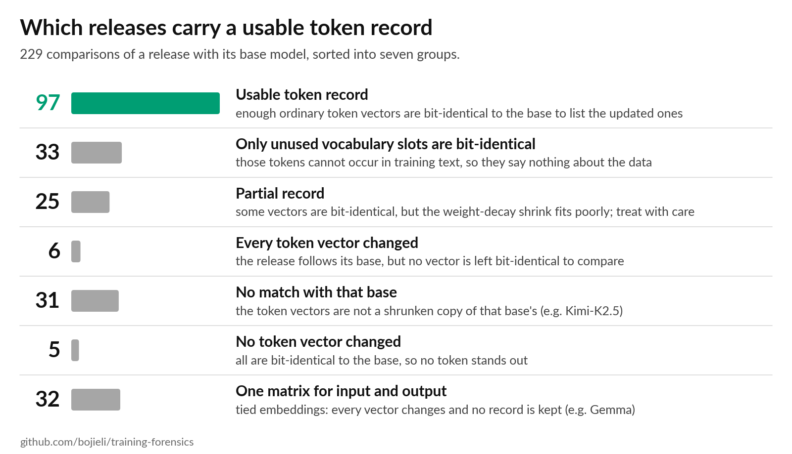

# training-forensics

**A fine-tune's weights keep a record of which vocabulary tokens its training data contained.**

Release a fine-tuned model next to its base model, and anyone can list which vocabulary tokens the training data
contained. Tokens the training never saw keep vectors that are bit-identical to the base, and comparing the two
files finds them. The list is a set of distinct tokens. It does not contain the text.

**Read the article:** https://x.com/bojie_li/status/2122536723041353841

The method is Alapan Chaudhuri's ([@alapanchaudhuri](https://x.com/alapanchaudhuri)), from
[his thread](https://x.com/alapanchaudhuri/status/2121439269772492848) of 14 Nov 2026. This repository is an
independent replication and extension. It holds 421 comparisons between a release and its base, covering 580
models ([`results/roster/COVERAGE.md`](results/roster/COVERAGE.md)), controlled fine-tunes with full ground truth,
and the code and result file behind every number.

## Headline findings

- **DeepSeek V4: six special tokens the README does not describe.** DeepSeek V4's two releases changed six
  special tokens that DeepSeek's encoding README does not describe, among them `<｜political｜>` and `<｜safety｜>`.
  The weights do not say what these tokens are for.
  [`results/frontier_ds/DEEPSEEK.md`](results/frontier_ds/DEEPSEEK.md) section 4;
  [details](#deepseek-v4-six-special-tokens-the-readme-does-not-describe).
- **DeepSeek-R1's training never touched its tool tokens.** DeepSeek's own paper says R1 could not use tools, and
  R1 left all nine tool tokens bit-identical to the base. R1-0528, the update that added function calling,
  updated all nine. [`results/frontier_ds/DEEPSEEK.md`](results/frontier_ds/DEEPSEEK.md) section 2;
  [details](#deepseek-r1s-training-never-touched-its-tool-tokens).
- **LIMO's published examples do not reproduce LIMO's weights.** 16,559 of the tokens that changed appear nowhere
  in the 817 published training examples. We do not know why, and none of this suggests training on test
  questions. [`results/published/PUBLISHED_LIMO.md`](results/published/PUBLISHED_LIMO.md);
  [details](#limo-thousands-of-tokens-changed-that-the-published-examples-never-use).
- **Reflection-70B: the card says Llama 3.1, the weights match Llama 3.** The repository's own config file says
  Llama 3 too. This was [first reported in 2024](https://www.reddit.com/r/LocalLLaMA/comments/1fb6jdy/reflectionllama3170b_is_actually_llama3/);
  we confirm it exactly. [`results/fp32scan/FP32SCAN_REFLECTION.md`](results/fp32scan/FP32SCAN_REFLECTION.md);
  [details](#reflection-70b-the-card-says-llama-31-the-weights-match-llama-3).
- **For five open reasoning projects, the published data and the weights agree exactly.** This is how we checked
  the method. One of them is s1: its published data contains 16,573 distinct tokens, and 16,573 token vectors
  changed. [`results/published/PUBLISHED.md`](results/published/PUBLISHED.md), controls in
  [`results/published/CONTROLS.md`](results/published/CONTROLS.md);
  [details](#five-projects-whose-published-data-matches-the-weights-exactly).



*Eleven neighbouring special tokens in DeepSeek V4's tokenizer. DeepSeek's README describes five of them. The
other six were updated in the same two releases, and a third-party fine-tune of the same base left all eleven
unchanged. Source: [`results/frontier_ds/v4_task_tokens.json`](results/frontier_ds/v4_task_tokens.json).*

**Timeline and status.** The thread appeared on 14 Nov 2026. Everything here was done in the days after it, with
heavy use of AI coding agents: the commit history starts on 15 Nov 2026 (see `git log`). A technical review of the first version
raised blockers and major issues. The answers are logged in [`FIXLOG/`](FIXLOG/), and this README reflects the
corrected numbers. How to rerun everything: [`REPRODUCE.md`](REPRODUCE.md).

**Contents.** [How the weights record the vocabulary](#how-the-weights-record-the-vocabulary) ·
[Findings on public models](#findings-on-public-models) · [Terms](#terms) · [More results](#more-results) ·
[Controlled runs and schedule recovery](#controlled-runs-and-schedule-recovery) ·
[Where the thread holds](#where-the-thread-holds-and-where-it-does-not-here) · [Reproduce](#reproduce) ·
[Limitations](#limitations) · [How to cite](#how-to-cite) · [Credit and license](#credit-and-license)

## How the weights record the vocabulary

A language model reads text as tokens, which are words or pieces of words. For every token in its vocabulary the
model stores a long list of numbers, called that token's vector (or embedding). Training adjusts a token's vector
only when the token appears in the training text.

So a token that never appeared keeps a vector that is bit-identical to the base, meaning every number is the same
down to the last binary digit.

Training leaves two finer traces as well. With Adam, the standard optimizer, a token seen in exactly one training
step has every number in its vector shifted by the same amount, about 31.8 times the learning rate late in a run
at a steady rate. The learning rate usually rises and then falls over a run, so the size of the shift works as a
timestamp for when the token was seen. And weight decay, a common setting that shrinks weights by a tiny fraction
at every step, shrinks all the vectors that never receive a correction signal (a gradient) by one exact factor,
which gives a way to test a guessed training schedule.



*The three traces training leaves in a token's vector: no change at all, one uniform shift, or one uniform shrink.
Schematic, not to scale.*

All counts in this README are of distinct vocabulary tokens and say nothing about how much text there was. The
exact form of the mechanism is in [The mechanism, in five lines](#the-mechanism-in-five-lines), and the words used
in the tables are defined in [Terms](#terms).

## Findings on public models

### DeepSeek V4: six special tokens the README does not describe

Report: [`results/frontier_ds/DEEPSEEK.md`](results/frontier_ds/DEEPSEEK.md) section 4. Data:
[`results/frontier_ds/v4_task_tokens.json`](results/frontier_ds/v4_task_tokens.json).

A vocabulary also contains special tokens, markers that never occur in normal text.

The [encoding README](https://huggingface.co/deepseek-ai/DeepSeek-V4-Pro/blob/main/encoding/README.md) shipped with
V4 describes tokens for auxiliary tasks. `<｜action｜>` decides between a web search and a direct answer,
`<｜query｜>` writes search queries, `<｜authority｜>` classifies how authoritative the sources need to be,
`<｜domain｜>` identifies the domain, and `<｜title｜>` writes a conversation title.

The weights agree with the README on those five. In both V4 base models the vectors of these tokens have the
overall size of a random start, and the V4-Flash and V4-Pro releases changed them.

The same block of the tokenizer holds six tokens that the README does not describe: `<｜task｜>`,
`<｜political｜>`, `<｜entity｜>`, `<｜safety｜>`, `<｜answer｜>` and `<｜search｜>`. We could not find these six
described anywhere public:

- not in the encoding README;
- not in DeepSeek's [reference encoder](https://huggingface.co/deepseek-ai/DeepSeek-V4-Pro/blob/main/encoding/encoding_dsv4.py)
  `encoding_dsv4.py`, whose task-token list `DS_TASK_SP_TOKENS` stops at action, query, authority, domain, title
  and read_url;
- not in the later [V4.1 README](https://huggingface.co/deepseek-ai/DeepSeek-V4.1-Flash/blob/main/encoding/README.md);
- searches in English and Chinese found no public discussion either.

The six changed in the same releases and in the same way as the documented ones. In V4-Flash and V4-Pro,
documented and undocumented tokens changed alike: 93-99% of their numbers, by similar amounts, not zeroed, copied
or rescaled, with changes that point in shared directions (38 of 45 pairs among ten of them, at both sizes). The
change in the `<｜political｜>` vector points in a similar direction to the changes in the documented authority and
domain classifier tokens, at both model sizes. For `<｜safety｜>` this holds at one of the two sizes. A third-party
fine-tune of the same base (Nex-N2.5-Max) left all of these tokens bit-identical. All of this is consistent with
further classification tasks of the same kind, trained on inputs that contain these tokens.

To check this yourself, look up ids 128,829 to 128,839 in the model's `tokenizer.json` (the eleven tokens are
contiguous), then compare each token's vector between the base and the release. The six undocumented tokens are
ids 128,833 (task), 128,834 (political), 128,835 (entity), 128,837 (safety), 128,838 (answer) and 128,839
(search).

In V4.1-Flash, a newer architecture with wider token vectors, the same eleven tokens sit at the same ids, and its
October update changed all six undocumented ones. DeepSeek has not released a V4.1 base, so we cannot check them
against a starting point there.

Three caveats apply. For the V4 bases we checked only that the vectors have the size of a random start, without
confirming the exact starting numbers, so light use of these tokens in pretraining is not excluded. A deliberate
small edit to the vectors, with a component shared between tokens, is not ruled out either. And the weights do
not say what the tasks are.

The obvious next test, which we have not run, is to append each undocumented token after a user message, the way
the README describes for the documented ones, and look at what the released model generates.

Classifying user prompts for safety is ordinary industry practice: Meta publishes
[Llama Guard](https://huggingface.co/meta-llama/Llama-Guard-3-8B), a separate model for exactly this. What is
unusual here is only that these tokens were updated but not documented.

### DeepSeek-R1's training never touched its tool tokens

Reports: [`results/frontier_ds/DEEPSEEK.md`](results/frontier_ds/DEEPSEEK.md) sections 1 and 2,
[`results/frontier/FRONTIER.md`](results/frontier/FRONTIER.md) section 1. R1-0528:
[`...V3-Base_--...R1-0528.json`](results/large/tokens/deepseek-ai__DeepSeek-V3-Base_--deepseek-ai__DeepSeek-R1-0528.json)
and [`...R1_--...R1-0528.json`](results/large/tokens/deepseek-ai__DeepSeek-R1_--deepseek-ai__DeepSeek-R1-0528.json)
in `results/large/tokens/`, category `tool-call` (`moved` 9, `moved_at_init` 9, `unmoved` 0).

DeepSeek-V3-Base has nine tool tokens: five that wrap a call to an external tool and four that wrap what the tool
sends back. All nine are still at their random starting values, regenerated exactly. Five later releases treated
them differently.

| Compared with V3-Base | 5 tool-call tokens | 4 tool-output tokens |
|---|---|---|
| DeepSeek-V3 | updated | bit-identical |
| DeepSeek-V3-0324 | updated | updated |
| DeepSeek-R1 | bit-identical | bit-identical |
| DeepSeek-R1-Zero | bit-identical | bit-identical |
| DeepSeek-R1-0528 | updated | updated |

Released models round their numbers, which could hide a tiny change. Not here: adding as little as 0.000001 to
every number would have altered at least 414 of each vector's 7,168 numbers, so R1's training did leave these
vectors alone.

The pattern is consistent with post-training data that never used these tool tokens for R1, and that used the
call tokens but never the output tokens for V3.

DeepSeek's documentation agrees. The [R1 paper](https://arxiv.org/abs/2501.12948) (arXiv 2501.12948) lists among
its limitations that R1 "cannot leverage tools, such as search engines and calculators", and expects the next
version to address this. The [release note](https://api-docs.deepseek.com/news/news250528) for the later
DeepSeek-R1-0528 lists function calling as newly supported, and R1-0528 updated all nine tool tokens, whether
compared with V3-Base or with R1 itself. With V4's README, this is the second case where the weights match what
the lab documented.

The caveat: the weights are consistent with R1's training never using the tool tokens. Alone, they cannot say
whether R1 could call tools some other way. For R1, the paper settles that.



*DeepSeek's 18 special tokens in four releases. Orange with "=" means the release left the vector unchanged from
V3-Base; blue means it was updated.*

Also in the report: V3-Base's 800 reserved slots are about 5x their starting size with changes in a shared
direction, consistent with appearing in pretraining input. DeepSeek's V4 releases updated all 800 and left 417
newer slots bit-identical.

### Five projects whose published data matches the weights exactly

Reports: [`results/published/PUBLISHED.md`](results/published/PUBLISHED.md), controls in
[`CONTROLS.md`](results/published/CONTROLS.md).

With a trainable input embedding, the tokens whose vectors changed should be exactly the tokens in the training
inputs. We took five open reasoning projects whose training data is public and compared two lists for each: the
distinct tokens that occur in the data, and the tokens whose vectors changed.

- s1: Qwen2.5-32B-Instruct fine-tuned on 1,000 published reasoning examples.
- s1.1, a second release from the s1 project: the same base, with a second set of 1,000 examples.
- Sky-T1: the same base, with about 17,000 examples.
- Bespoke-Stratos: two models, on the same base and on Qwen2.5-7B-Instruct, sharing one set of about 17,000
  examples.
- OpenThinker: Qwen2.5-7B-Instruct, with about 114,000 examples.

For all five, at both Bespoke-Stratos sizes (7B and 32B), the two lists are equal, token for token. The data is
tokenized with each project's own training code (trl for s1, LLaMA-Factory for the others; the last position of
each sequence excluded, since without packing it gets no gradient):

| Fine-tune | Release | Tokens in data | Vectors changed | Verdict |
|---|---|---|---|---|
| simplescaling/s1-32B | float32 | 16,573 | 16,573 | exact match |
| simplescaling/s1.1-32B | float32 | 27,154 | 27,154 | exact match at the documented 20,000-token block size |
| NovaSky-AI/Sky-T1-32B-Preview | float16 | 48,015 | 48,015 | exact match |
| bespokelabs/Bespoke-Stratos-32B | bfloat16 | 43,761 | 43,761 | exact match |
| bespokelabs/Bespoke-Stratos-7B | bfloat16 | 43,761 | 43,761 | exact match |
| open-thoughts/OpenThinker-7B | bfloat16 | 65,554 | 65,554 | exact match with the framework's default system prompt |



*For five projects, the tokens found in the published training data are exactly the tokens whose vectors changed
in the released model.*

Counting the tokens in a dataset means preparing the text the way the training run did, with a length limit at
which documents are cut off and a system prompt placed in front. Each match holds at exactly one tested
combination of cutoff and system prompt, except s1, which matches at every block size from 16,384 up because its
documents are shorter. That combination is the one the project documents for s1 (block size 32,768 in
`train/sft.sh`), s1.1 (20,000 in the s1 README), Sky-T1 (cutoff 16,384 and the data's system prompt in
SkyThought's LLaMA-Factory yaml) and OpenThinker-7B (cutoff 16,384 and no system column in its yaml, so the
framework default). For Bespoke-Stratos it is documented only by reference (its cards point to Sky-T1's training
code and list the same hyper-parameters). Sources, pinned to commits, are in
[PUBLISHED.md](results/published/PUBLISHED.md#where-the-matching-setting-comes-from).

The weights confirm s1.1's limit of 20,000 tokens. s1.1 matches only at 20,000: the 49 in-data tokens that stayed
bit-identical all first occur at position 20,022 or later, and every changed token occurs by position 19,901.

**What a wrong dataset looks like.**

- Wrong data shows up clearly. Scoring each model against a different published dataset gives 166-49,147
  mismatches.
- Missing data shows up too. Leaving out a random 1% of the documents would remove 60-104 tokens.
- Extra data is the weak spot. Set equality cannot rule out individual documents with no unique token, or extra
  documents whose tokens all occur elsewhere (an extra OpenThoughts-style document would add a new token only
  2-31% of the time).

Three larger cases come close without being exact; each has its own entry under
[Follow-up studies](#follow-up-studies). Tulu 3 405B's supervised training stage updated all but 245 of the
124,572 tokens in its published data and no other regular token, while its later preference-tuning stage does not
match its data in this way. WebWorld, trained on a published 52 GB dataset, updated 99.0% of that dataset's
vocabulary; at 8B and 14B it updated nothing outside that vocabulary, and at 32B it updated 2 tokens outside it.
Arete-27B matches its published answers, with 63,392 of 63,900 tokens updated and nothing outside them.

### LIMO: thousands of tokens changed that the published examples never use

Report: [`results/published/PUBLISHED_LIMO.md`](results/published/PUBLISHED_LIMO.md). Rerunnable check with
pinned revisions in `scripts/limo_check/`, outputs in `results/limo_check/out/`.

LIMO is a reasoning fine-tune of Qwen2.5-32B-Instruct. Its published 817 training examples do not reproduce its
weights.

GAIR/LIMO changed 29,742 token vectors. The published 817-example set has 13,386 distinct tokens (at a
16,384-token cutoff), of which 13,183 changed and 203 never received a gradient. A further 16,559 changed tokens
do not occur in it. Of these, 5,391 are CJK (Chinese, Japanese or Korean) tokens, while the published text has 46
CJK characters.

An earlier revision of the model repository still held the DeepSpeed optimizer state, the trainer's own
bookkeeping. It shows that exactly those 29,742 vectors received gradients, in one run of 801-832 examples per
epoch (epoch 9 of a planned 15; output directory named `aime817_deepseek-r1`). That is consistent with one run of
about the published size, and not with a larger corpus.

The questions are consistent with the published ones. The solution text used in training differs from the
published one for at least 61 examples at the 16,384 cutoff the paper states (19-76 depending on the cutoff; 76 at
the 32,768 in the release-day config), and the weights cannot say how many more differ. The 16,559 absent tokens
would need about 2,336 differing examples at the average rate of new tokens per example, more than the set holds,
so the trained text of the differing examples must have been very unlike the published text.

We do not know what that text was or why it differs. We report no evaluation-set coverage counts and make no
contamination claim; none of this suggests training on test questions. A check against the logged `total_flos`
was inconclusive.

LIMO-v2: 279 changed tokens are absent from its published set (261 after tokenization variants), all ASCII.

### Reflection-70B: the card says Llama 3.1, the weights match Llama 3

Report: [`results/fp32scan/FP32SCAN_REFLECTION.md`](results/fp32scan/FP32SCAN_REFLECTION.md). Independent check
with pinned revisions in `results/reflection_check/`.

This is not a new finding. Days after the 2024 release, an
[r/LocalLLaMA analysis](https://www.reddit.com/r/LocalLLaMA/comments/1fb6jdy/reflectionllama3170b_is_actually_llama3/)
compared the weights and found them much closer to Llama 3 than to Llama 3.1. We confirm it with exact counts.

The model card of Reflection-Llama-3.1-70B names Llama-3.1-70B-Instruct as the base. The repository's own
`config.json` names Meta-Llama-3-70B-Instruct, and the weights agree with the config.

- The first upload (5 Sep 2024) is bit-identical to Llama-3.1-70B-Instruct in every tensor we sampled.
- The current weights (6 Sep 2024) derive from Llama-3-70B-Instruct, not 3.1. All normalisation weights and
  51,241 of 128,256 token vectors are bit-identical to it, and none to any Llama 3.1/3.3 model.
- In 35 sampled projection matrices the difference from Llama 3 has rank at most 256, meaning it can be built
  from at most 256 independent components. The embedding and output matrix changed differently.
- A third upload is listed in the report. References were verified byte-identical to Meta's releases by sha256.

The weights do not establish the training method, and they say nothing about intent.

### OLMo 2: a tokenizer mismatch, recorded in the weights

Report: [`results/public/PUBLIC_CLAIMS.md`](results/public/PUBLIC_CLAIMS.md) section 3.

AI2 replaced OLMo 2's first instruction-tuned release with a retrained one. The model card says the post-trained
models "did not share the pre-tokenization logic that the base models use" and that new ones were trained. The
card does not mention the weights. Chaudhuri showed that they record the mismatch, and we reproduce that. In the
first release 23,064 tokens are bit-identical to the base, and 20,878 of them occur in the training data. One of
these is the token that closes every chat-role marker, which occurs 2,389,430 times. In the retrained release the
count of bit-identical tokens is 2,802.

### Three model cards that name a different base

Reports: [`results/published/WEBWORLD.md`](results/published/WEBWORLD.md),
[`results/frontier/lineage.md`](results/frontier/lineage.md),
[`results/y2026_ft/FT2026.md`](results/y2026_ft/FT2026.md).

- **WebWorld.** The Hugging Face cards name Qwen3-8B as the base of all three sizes. The project's GitHub README
  names Qwen3-8B, 14B and 32B, and the weights agree with the README. The card metadata looks like a copy of the
  8B entry.
- **Qwen-AgentWorld-35B-A3B.** The card names the Qwen3.5 base. After untrainable tokens are removed, the model
  shares 614 bit-identical token vectors with Qwen3.6-35B-A3B and 13 with the Qwen3.5 models. Another
  Qwen3.6-based model (KAT-Coder-V2.5-Dev) shares 594 with it, so the weights identify a family, not a single
  parent or which model came from which.
- **MemT-1.0-Flash.** The card names DeepSeek-V4-Flash. Its closest published starting point is the later
  V4-Flash-0731, with which it shares 16,806 vectors against 82 for the original. The card may be naming the
  model family.

### Qwen3 left its image tokens unchanged, and a token list we over-read

Reports: [`results/frontier/FRONTIER.md`](results/frontier/FRONTIER.md) section 4 and its figures note,
[`results/frontier_x/FRONTIER_X.md`](results/frontier_x/FRONTIER_X.md).

Qwen3-8B and Qwen3-14B left the same 11 image, video and grounding tokens bit-identical to their bases, apart from
the uniform shrink that weight decay applies to every untouched vector. Both updated all 15 chat, tool, thinking
and code tokens. That is consistent with text-only post-training.



*How many special tokens of each kind were updated (blue) or left unchanged (orange) in 13 releases from other
labs, each compared with its own base. Yellow marks tokens that barely changed, and hatched grey marks the one
release that cannot be tested.*

In DeepSeek-R1-Zero, 8.0% of token vectors are bit-identical to the base, and another 61.5% have fewer than 10% of
their numbers changed. We first took that to mean the training data was narrow, which was more than the evidence
supports. AI2's Olmo-3 RL-Zero models, whose reinforcement-learning-only recipe is published, are lightly changed
too, at 53.6% and 91.9% on the same measure. Vectors that barely changed could come from reinforcement learning,
from a low learning rate or from narrow data, and this measure cannot tell these apart.

### Where there is no token record

Some models, Gemma among them, use a single matrix of token vectors for both reading input and producing output
(tied embeddings), and keep no record. Of our 229 core comparisons between a release and its base, 97 give a
record of which tokens were trained ([`results/frontier/FRONTIER.md`](results/frontier/FRONTIER.md) section 7; the
seven classes are in [the roster section](#the-265-model-roster)).



*Of 229 release-and-base comparisons, 97 carry a usable token record. The rest fall into six groups where the
method says less or nothing.*

Some methods never touch the token vectors. LoRA, a popular low-cost method that trains small add-on matrices,
leaves them alone when it is applied to other layers, and so do edits that remove a model's refusals. 13 of the 29
popular 2026 fine-tunes we compared leave the token vectors bit-identical to the base
([`results/y2026_ft/FT2026.md`](results/y2026_ft/FT2026.md)). And when every vector in a model has changed, that
is never evidence that every token was in the data.

The harder results we reproduce only in part. Recovering the training schedule works on our own runs with round
settings, and only partly with non-round ones: the rewritten tool recovered 2 of 4 blind runs and flagged the
other 2 instead of guessing wrong. Our per-document results (which step a document was used in, swapped
documents, whether a given document was in the training data) are weaker than the thread's. See
[Controlled runs and schedule recovery](#controlled-runs-and-schedule-recovery) and
[Limitations](#limitations).

## Terms

- **Token vector (embedding).** Every token in a model's vocabulary has its own vector of numbers. In the
  code and tables this is one *row* of the embedding matrix; counts of rows are counts of distinct
  vocabulary tokens, never amounts of text.
- **Updated / bit-identical.** A token vector is *updated* (*moved* in table columns) when training changed it
  beyond weight decay, and *bit-identical to the base* (*unmoved*) when every one of its numbers equals where it
  started (after the common weight-decay shrink, where there is one).
- **Parent -> fine-tune pair.** A model and the model trained from it, e.g. Qwen2.5-7B -> Qwen2.5-7B-Instruct.
- **Shrink factor P and total weight decay.** With decoupled weight decay an untouched vector is multiplied by
  (1 - lr x wd) at every step; P is the product over all steps and -ln P = sum of lr x wd, the *total weight
  decay applied*. It gives the product of learning rate and weight decay, summed over the run, not either one alone.
  In a 16-bit release P = 1 means "no shrink resolvable" (below a bound, median 0.195%), not "no weight decay".
- **Tied embeddings.** Models that use one matrix for both the input tokens and the output layer. The output
  layer sends a gradient to every token at every step, which erases the record.
- **Special tokens.** Chat markers, tool-call, thinking, image-placeholder and fill-in-the-middle tokens.
- **16-bit release.** Weights published in bf16/fp16. One *16-bit step* is the smallest change a 16-bit number can
  show. What that rounding hides is stated once, under [Limitations](#limitations).
- **How sure.** *Recovered exactly* = bit-exact, checked; *estimated* = a fit with error; *bounded* = only a
  range; *detected* = a yes/no test with a measured false-alarm rate; *assumed* = rests on a stated assumption.

## More results

### The four public claims from the thread (`results/public/PUBLIC_CLAIMS.md`)

| Claim | Verdict | What the weights show |
|---|---|---|
| Pythia-1B peak learning rate is 2.5e-4, not the card's 3.0e-4 | **confirmed** | 2.50002e-4, estimated from how the unused padding vectors shrank over 154 checkpoints; the yml config agrees. All 8 sizes land within 0.2% of their configs. |
| Pythia's learning rate is flat for its last ~28,000 steps (cosine to 0 clipped at 0.1x peak) | **confirmed** | clip at 0.1000x peak at every size; flat tail 27,657-27,865 steps (predicted 27,861). Today's gpt-neox scheduler fits 47-227x worse. |
| OLMo-2 first SFT release: ~20,341 tokens that should have been trained were never updated, incl. the chat-turn closer | **confirmed, count differs** | 23,064 real tokens bit-identical to base; 20,878 of them occur in the SFT data (20,358-20,878 under three definitions; the gap to 20,341 is unexplained). `>Ċ` (id 397, 2.39M occurrences) is bit-identical to the base in the first release (a 16-bit release); it was updated in the retrain. |
| Qwen2.5 instruct updated exactly 4 of 22 special tokens, same 4 at 7B/14B/32B/72B | **confirmed** | `<\|im_start\|>`, `<\|im_end\|>`, `<tool_call>`, `</tool_call>` at all four sizes; the other 18 bit-identical. |

Side findings: pythia-12b checkpoints `step50000`/`step58000` contain the final model's padding vectors;
pythia-2.8b's padding vectors are bit-identical to step 0 in 85 of 153 later checkpoints (incl. the final one).

### The 265-model roster

Every model of the roster of the sibling project
[checkpoint-forensics](https://github.com/bojieli/checkpoint-forensics) has a line in
[`results/roster/COVERAGE.md`](results/roster/COVERAGE.md): **186 of 265** give a pretraining estimate or a
fine-tune comparison, 52 more serve only as the reference parent of an analysed fine-tune, and the remaining
27 have no record (no untouched vectors, vectors rewritten after training, JAX/TPU or Ascend initialisation),
each with its reason.

**Base models: pretraining weight decay from never-trained token vectors** ([`PRETRAIN_DECAY.md`](results/roster/PRETRAIN_DECAY.md)).
Tokens that never occur in pretraining (and unused padding slots) keep their random starting values, shrunk
only by weight decay. checkpoint-forensics regenerates those starting values bit for bit; the spread that
reproduces the published vectors is init_std x P. So, *if init_std is known*, the weights give the total weight
decay applied in pretraining with no checkpoints at all.

- 175 models give an estimate: 37 only the list of never-trained tokens, 138 a comparison with the regenerated
  starting values. Of the 138, by how sure:
  - **8 Pythia sizes, 7 validated**: 70M, 160M, 410M, 1B, 1.4B, 6.9B and 12B agree with an independent
    measurement from the public checkpoints to 1e-4; 2.8B's checkpoint series is unusable, so it is not
    validated. The init that makes them agree is gpt-neox small_init for <= 2.8B and std 0.02 for 6.9B/12B;
  - **5 exactly no decay**: the spread equals the configured init exactly (OLMo-3 / OLMo-3.1 / OLMo-7B-Twin among them);
  - **24 no decay, inferred**: the spread is a round number, e.g. exactly 0.006 for DeepSeek-V2/V3/V4 (the init
    std in DeepSeek's paper); a decayed value is almost never round, but this is an inference;
  - **69 assumed**: a decay value that assumes the vectors started at the config's `initializer_range`; a wrong
    init convention moves P by ~2x, as Pythia shows;
  - **20 implausible for decay alone** (P < 3e-7 under the assumed init, e.g. Kimi-Linear): rescaled or zeroed otherwise;
  - **12 init unknown**: no value.
- GLM-4.5 through GLM-5.3 give 5.98-6.16 (assumed init), rising slightly release by release: most likely
  never-trained vectors inherited through continued training of one base, not a shared recipe.

**Fine-tunes: parent -> fine-tune comparisons** ([`SWEEP.md`](results/roster/SWEEP.md)).

Every public parent -> fine-tune pair in the roster whose token vectors can be compared: **229 pairs**
(197 with separate input and output matrices, 32 tied), token vectors fetched by HTTP range requests and
compared token by token. Across the roster and all follow-up studies there are 421 distinct comparisons over
580 models.

- **Seven classes** ([`results/frontier/FRONTIER.md`](results/frontier/FRONTIER.md) section 7,
  `scripts/frontier/comparability.py`, thresholds calibrated in `results/frontier/calibration.json`):

  | Class | Pairs | What it means |
  |---|---|---|
  | Token record | 97 | At least 50 *trainable* token vectors bit-identical after removing decay (unreachable, reserved, never-trained, zero and duplicate vectors are not counted), and the decay fit reproduces >= 99% or no shrink is resolvable. The list of tokens the fine-tune's data contained is detected. This shows shared ancestry, not a direct parent. |
  | Only untrainable tokens shared | 33 | The shared vectors are all untrainable (shared random start): no data or lineage evidence. |
  | Some bit-identical, decay fit below 99% | 25 | Token lists to be read with care. |
  | Every token changed, fit above every separately trained pair | 6 | Fit above 0.521 (largest value among 25 separately trained pairs: 0.471). |
  | Not a decayed copy of that base | 31 | e.g. Qwen3-235B-2507, Kimi-K2.5. |
  | Embedding unchanged | 5 | Re-uploads, conversions, frozen vectors; light training with a shrink below the 16-bit bound is not excluded. |
  | Shared input/output matrix (tied) | 32 | No record (e.g. Gemma). |

  Calibration: of 25 separately trained pairs sharing a tokenizer, 0 are classed "token record" (1 before the
  vectors were cleaned). This null is mostly Pythia variants (21 of 25); only Qwen2-7B vs Qwen2.5-7B shares any
  vector, so it is the one informative null pair. Of 39 distinct sibling pairs (two children of one parent), 12 are
  classed "token record". So no class names a direct parent. Before the review the classes were 114 / 11 / 25 / 42 / 5 / 32.
- **Lineage uses a margin rule** ([`results/frontier/lineage.md`](results/frontier/lineage.md)): a starting point is
  named only if its cleaned count of bit-identical vectors leads every other candidate (siblings, ancestors) by
  1.5x and 200 vectors. 16 statements hold; 9 are reworded to "shares never-trained vectors with X and Y".
- **Tied embeddings erase the record** (28 of 32 tied pairs keep fewer than 10 untouched vectors; 2 are
  unchanged), and so do separate output layers: in 105 of 107 measured, >= 99% of output vectors were updated or
  barely changed (93 if barely changed vectors are not counted). The output softmax sends a gradient to every token.
- **Special tokens.** Qwen2.5-Instruct updated the same 4 of 22 at 7B/14B/32B/72B (the thread's claim);
  Qwen2.5-Coder updated the fill-in-the-middle and repo/file tokens, Qwen2.5-Math only `<|endoftext|>`; the full
  table covers every family. An updated special token can also be a vendor edit (KAT-Dev's are zeroed).
- **Weight decay** is visible in 25 pairs (plus KAT-Dev, whose untouched vectors are zeroed, not decayed).
  21 pairs give a range of P that reproduces the same vectors (conditional on the fitted P; `p_intervals.json`,
  `results/frontier/decay_ranges.json`), widened by the largest simulated fp32 rounding drift. Qwen3-8B/14B/30B-A3B:
  a shrink of 1.30-1.31% for one multiplication, 1.25-1.37% with the drift allowance, for all three (the range is
  set by the 16-bit grid, so this means "agree within that range", not "same recipe"). Correction to our own first
  pass: five releases (Llama-3.1/3.3 Instruct, Nemotron-3-Ultra, LLaDA-MoE-v2) seemed to share P = 0.994148; their
  untouched vectors shrank by exactly one 16-bit step, which only bounds the total weight decay to [0.0039, 0.0059]
  ([0.0033, 0.0065] with drift), and the shared value is that range's edge, not a shared recipe.
- **Single-step timestamps do not survive public 16-bit releases** at today's batch sizes: only 5 pairs
  have >= 20 tokens with the single-step signature, and their changes are 1-3 16-bit steps. No learning rates
  are estimated from them.

### Follow-up studies

Each has its own generated report with sources; wording rules in [`STYLE.md`](STYLE.md). Article figures:
[`results/figures/`](results/figures/).
The DeepSeek, published-data, LIMO and Reflection studies are described under
[Findings on public models](#findings-on-public-models) and are not repeated here.

- **Frontier claims checked** ([`results/frontier/FRONTIER.md`](results/frontier/FRONTIER.md)). Qwen3-8B/14B
  leave the same 11 image/grounding tokens bit-identical; Qwen3-30B-A3B's special-token vectors were replaced,
  so it cannot be tested; Qwen3.5-35B-A3B leaves 11 of 18 image/audio tokens bit-identical. In 16-bit releases
  many vectors change too little to be told apart from untouched: DeepSeek-R1-Zero has 61.5% of its vectors with
  under 10% of their numbers changed (R1: 8.4%, V3-0324: 2.8%).
- **58 more frontier comparisons** ([`results/frontier_x/FRONTIER_X.md`](results/frontier_x/FRONTIER_X.md)):
  18 token records, 14 with only untrainable tokens shared, 8 with a poor fit, 3 changed throughout, 8 not
  comparable, 7 tied. Small-update footprints like R1-Zero's also occur in documented RL-only runs (Olmo-3-7B
  RL-Zero-Math: 53.6% of vectors with under 10% of their numbers changed, RL-Zero-Mix 91.9%, R1-Zero 61.5%), so
  the footprint is not by itself evidence of narrow data; it does not separate RL from low-learning-rate or
  narrow-data training either. Several successive releases are not decayed copies of the previous public
  checkpoint (MiniMax M2->M2.1 and M2.5->M2.7, GLM-5.1->5.2->5.3, Kimi K2-Thinking->K2.5, the LongCat-Flash
  chain). Kimi K2.5 is K2.6's closest published starting point (628 cleaned bit-identical vectors against at most
  13 for any other candidate). **Withdrawn:** "the DeepSeek chain V3->V3-0324, V3.1-Base->V3.1,
  V3.2-Exp->V3.2->V3.2-Speciale are direct descendants". V3.1-Base->V3.1 and V3.2-Exp-Base->V3.2-Exp hold under
  the margin rule; V3-0324 shares more cleaned vectors with V3-Base (1,160) and R1 (1,015) than with V3 (754),
  and V3.1-Terminus, V3.2 and V3.2-Speciale share never-trained vectors with two candidates each.
- **Which tokens each fine-tune's data contained** ([`results/tokens/TOKENS.md`](results/tokens/TOKENS.md)):
  116 fine-tunes with >= 10 bit-identical vectors, by script, language, code, digits, emoji and special tokens,
  with detection-floor, reachability, starting-size and hand-edit checks and a negative control
  (unrelated models sharing a tokenizer). Qwen2.5's base holds its chat and tool-call tokens at ~0; in the
  instruct releases they are updated, at all four sizes.
- **Quantized releases and merges** ([`results/quant_merge/QUANT_MERGE.md`](results/quant_merge/QUANT_MERGE.md)):
  of 77 quantized releases of 22 models, 42 keep the input token vectors equal to the official release, 13
  quantize them but still give the updated tokens with no false flags against the base quantized the same way
  (tokens with tiny updates are missed: about 0.1% in GGUF Q4_K/IQ3_S and MLX, 0.2-0.9% in Q8_0 copies of
  DeepSeek models), 6 are reproduced bit for bit from the official release, 6 could not be assessed because
  weight decay changed every vector, 6 are unscored, 3 not checked, 1 changed.
  `baseten/DeepSeek-V3-FP4`'s token vectors equal DeepSeek-V3-0324's for all 129,280 tokens.
  Merges (partial, on our own models): linear, SLERP, task-arithmetic, TIES and DARE keep tokens no
  parent updated bit-identical; model_stock does not.
- **Pretraining schedules from public checkpoint series** ([`results/series/SERIES.md`](results/series/SERIES.md)),
  learning rates assuming the published weight decay, with 16-bit bounds: OLMo-7B-0724's published schedule
  (warm-up from 0.1x peak) is reproduced with a median ratio of 1.0000 over 805 intervals, and 771 of 818 intervals
  lie inside the exact bounds; OLMoE to 0.08% per interval, with the cosine planned for 5.0T tokens though training
  ran to 5.13T; Apertus-8B's stable learning rate is 1.100e-4; Viking-7B follows its card within 1% in 8 of 9
  intervals (one interval 3.7% low, cause unknown); Amber's untouched vectors do not shrink for 259 of 360 chunks,
  which coincides with its checkpoints switching from 16-bit to 32-bit. Withdrawn: an earlier "OLMo-7B-0724 config
  disagrees with its card" (we compared the wrong config file) and "K2's floor is 0.092x" (within 16-bit rounding).
- **WebWorld 8B/14B/32B vs the published 52 GB training set** ([`results/published/WEBWORLD.md`](results/published/WEBWORLD.md)).
  No changed token lies outside the published data at 8B and 14B (2 at 32B); 99.0% of the data's vocabulary was
  updated (141,536 of 142,952); the weights point to a training length limit near 20,000 tokens, with a 0.2%
  residual the weights do not explain. Scored against the wrong data, 114,364 changed tokens fall outside it.
  The Hugging Face card metadata names Qwen3-8B as the base of all three sizes; the project's GitHub README names
  Qwen3-8B/14B/32B, and the weights agree with the README.
- **Seed and batch size of public fp32 fine-tunes** ([`results/fp32scan/FP32SCAN.md`](results/fp32scan/FP32SCAN.md)).
  Of the popular models scanned, 630 are stored in fp32 and 173 of those name a base model. For s1-32B and
  s1.1-32B (fp32 master weights, public data and script), the published weight decay of 1e-4 is a no-op in fp32.
  Assuming the published cosine schedule with 5% warm-up, beta2 0.95, 5 epochs and Trainer's seedable sampler,
  seed 42 with batch 16 fits best of 6,003 candidates for both, and stays first in 300 of 300 bootstrap
  resamples. Batch 16 matches the published script; seed 42 is the Trainer default (the script sets none).
  Individual documents' steps follow from the seed but are only weakly confirmed one at a time.
- **Large fine-tunes of frontier models** ([`results/large/LARGE.md`](results/large/LARGE.md)), 29 comparisons.
  Tulu-3-405B SFT against its published mixture: all but 245 of the 124,572 tokens in the data were updated
  (39 of the 245 occur more than 5 times) and no other regular token changed; "nothing outside" is tested on the
  3,684 vocabulary tokens the mixture lacks. The DPO stage does not match its mixture (2,188 in-data tokens
  bit-identical, 399 changed outside). Hermes-4 405B's cleaned set of 2,461 bit-identical tokens lies inside the
  70B release's 2,482; 97% of them are also bit-identical in Hermes 3, so this is weak evidence about Hermes 4's
  own data. r1-1776 and MAI-DS-R1 against DeepSeek-R1 are low-signal: category counts only. The end-of-sequence
  token is bit-identical after DPO/RL stages (Tulu, MAI-DS-R1, AceReason, Skywork-OR1), consistent with unpacked
  training. Lineage under the margin rule: AM-Thinking-v1 from the Qwen2.5-32B base, Nemotron-Ultra-253B from
  Llama-3.1-405B-Instruct; QwQ-32B and Hermes-4-405B share never-trained vectors with two candidates each.
  Kimi-Dev-72B and KAT-Dev-72B-Exp have the same 2,171 vectors set to zero (unused slots and unreachable
  tokens); an observation, with no claim about how.
- **2026 lab releases** ([`results/y2026_labs/LABS2026.md`](results/y2026_labs/LABS2026.md)): 435 releases from
  42 lab accounts found, 78 new comparisons. Qwen-AgentWorld-35B-A3B's card names the Qwen3.5 base; it shares
  614 never-trained vectors with Qwen3.6-35B-A3B and 594 with KAT-Coder-V2.5-Dev (another Qwen3.6 fine-tune) against 13
  with the Qwen3.5 models, so the weights place it in the Qwen3.6 line without naming a starting point. Atria-Dawn-Preview's
  closest published starting point is GLM-5.2; Sage-S2.1 shares never-trained vectors with both GLM-5.2 and
  Atria-Dawn-Preview. Several 2026 flagship successors are new token vectors, not trained copies of the previous
  public release (Kimi K3 line, MiniMax M3, Step-5, Qwen3.6/3.8, MiMo V2.6); some special tokens stay
  bit-identical after post-training (fill-in-the-middle tokens in Ling and Hy3).
- **2026 fine-tunes** ([`results/y2026_ft/FT2026.md`](results/y2026_ft/FT2026.md)), 32 comparisons of 29 distinct
  fine-tunes. Arete-27B's token vectors match its published SFT answers (63,392 of 63,900 tokens in the training
  text updated, nothing outside it; the reasoning traces were not trained on, as the dataset card states). The
  weights together with the per-example token counts Nous published are consistent with a plain concatenation
  without chat markers; the weights alone do not single that format out (`results/arete_check/`; Nous's data file
  is fetched by `scripts/arete_check/fetch_nous.py`, not redistributed). 13 of the 29 distinct fine-tunes (32 comparisons) leave the input embedding
  bit-identical (LoRA tunes, trace distills, refusal-removal edits), so they carry no token record.
  MemT-1.0-Flash's card names DeepSeek-V4-Flash; its closest published starting point is V4-Flash-0731 (16,806
  cleaned bit-identical vectors against 82).
- **Previously gated models** ([`results/gated/GATED.md`](results/gated/GATED.md)): open copies of Llama weights
  verified byte-identical to the official releases by sha256. Apertus-v1.5-70B base -> SFT -> RL -> release is a
  clean chain; Hydrogen-1.0's closest published starting point is GLM-5.3 (103,495 against 24), as its card says;
  Cohere's tiny-aya shares one matrix for input and output, so it has no record.

## Controlled runs and schedule recovery

This part tests the thread's harder claims on fine-tunes we trained ourselves, where the ground truth is known:
recovering the learning-rate schedule, the number of steps, the shuffle seed, and which optimizer step each
document was used in.

### The mechanism, in five lines


1. Fine-tune with Adam(W) and subtract the starting token vectors, token by token.
2. A token the data never contained gets no gradient: its vector is not updated (with decoupled weight
   decay it only shrinks by a factor that is the same for every such token).
3. A token seen in exactly one optimizer step changes by the same amount D in nearly every number of its
   vector: Adam divides a first gradient by its own magnitude, so only the sign survives.
4. D depends only on the learning rates from that step on: D(s) = sum_k lr(s+k) a(k, s). For a constant learning
   rate, default Adam settings and a late step (full bias correction) D/lr -> 31.77; early steps and gradients near
   Adam's eps give less, which the estimation handles with an intercept fit. So D says *when*; the sign pattern
   says *what* (minus the sign of that step's gradient).
5. Under decoupled weight decay every number goes through the same sequence of fp32 multiplications,
   so the untouched vectors can be replayed bit for bit once the schedule is known.

`trainforensics/adam.py` is the forward model; `trainforensics/blind.py` does the estimation;
`scripts/controlled/score.py` analyses a run blind and only then opens its ground truth.

### Controlled fine-tunes (`results/controlled/CONTROLLED.md`, `results/gaps/GAPS.md`, `results/fixc/FIXC.md`, `results/fixe/FIXE.md`)

24 fine-tunes with full ground truth: Pythia-160m/410m (full fine-tuning) and Qwen2.5-7B (token vectors +
output layer, LoRA with trained token vectors, weight decay, batch 128, two epochs), linear / cosine / constant /
cosine-to-floor / warmup-stable-decay schedules, batch 4-128, weight decay 0-0.1. Each run is analysed
from (start, release) and only then scored against the trainer's logged learning rates and batches. All 24 are
scored with one version of the code (the five Qwen2.5-7B runs were retrained for this).

**Scope of these numbers.** The 24 runs are single-epoch (one is two-epoch and unsolved), use round
hyper-parameters, seeds below 100,000 and one of the reader's five schedule families. Non-round settings were
tested twice, each time on runs trained *after* the reader was frozen. Reader v1 recovered the schedule on 2 of 5
such runs (non-round learning rates and weight decay, two random 32-bit seeds, one schedule outside the five
families). Reader v2 was built to fix that; on four further runs it recovered two exactly and reported the other
two as "not recovered" (rows "fresh runs" below).

| What is recovered or estimated | Result |
|---|---|
| Tokens seen (updated vectors = tokens in the data) | **recovered exactly in 24 / 24**, no false positive: directly where there was no weight decay, and via the bit-exact decay replay (which needs the full recipe) where there was. The direct comparison alone misses 10-469 late-updated tokens in decay runs. |
| Recipe: schedule, steps, warm-up, peak (and weight decay) | **exact in 22 / 24**; peak within 0.12% before rounding to a round value. Misses: r05 (501 steps read for 500) and the two-epoch run. |
| Step count from the weights alone (no claimed dataset or batch size) | Kind, step count and warm-up right in **24 of 25** pre-existing Pythia runs; the dataset-implied step count was never needed. |
| Fresh runs, reader v1 (five runs trained after v1 was frozen, tag `fixc-frozen`) | Full schedule recovered in **2 of 5**. Two with non-round weight decay misread (0.013 read as 0.015; 738 steps for 500), one out-of-family schedule wrong. Each wrong recipe shows in the replay check (28 to 802,448 of about 24.4M weights bit-exact, against 24,419,699 when right). The direct token list had no false positive in any of the five. |
| Reader v2 on the runs it was developed on ([`results/fixe/FIXE.md`](results/fixe/FIXE.md)) | v2 fits the weight decay continuously (v1 tried round values only) and chooses the schedule by bit-exact replay of the never-updated weights. It reports a recipe as recovered only if the replay reproduces at least 95% of a sample of those weights (correct recipes reproduce 98-100%). The five v1 fresh runs were used to develop it, so they are not a blind test of v2. On n03 (linear, weight decay 0.013) v1 was wrong: warm-up 18 for 17, decay 0.015, and its replay listed 31,687 tokens as updated that were not in the data. v2 is exact there: schedule, step count, warm-up and every step's decay factor, the seed, the token list (18,617 / 18,617, no false positive) and 1,113 documents in their exact step (3 wrong). n02 (inverse square root, outside the five families) and n05 (cosine to a floor, warm-up 31) are still wrong and are now reported as not recovered (2% and 59% of the sample reproduced). Every earlier run with weight decay that was re-scored (seven controlled runs, six training setups) gives the same recipe, seed, token list and document steps as under v1. |
| Fresh runs, reader v2 (four runs trained after v2 was frozen, tag `reader-v2-frozen`, commit ef4ad5c; analysed blind) | Non-round peak learning rate, weight decay, step count and warm-up; seeds below 100,000. **2 of 4 recovered** (f01 linear, f02 cosine): schedule, step count, warm-up and every step's decay factor exact, seed recovered, token list exact via replay (17,572 / 17,572 and 20,091 / 20,091, no false positive), 1,132 and 1,413 documents in their exact step (1 and 2 wrong), 25,138,178 of 25,214,208 and 23,205,677 of 23,524,608 never-updated weights bit-exact (one step off: 28 and 470). **2 of 4 reported as not recovered**: f03 (cosine to a floor, a schedule the reader models; 55% of the sample reproduced) and f04 (inverse square root, which it does not model; 8%). No wrong recipe was reported as recovered. |
| Change made after the v2 freeze (v2.1, tag `reader-v2.1`, commit 696ef43) | When the replay confirms no candidate, v2.1 reports the v1 estimate, still marked not recovered, where v2 reported its best unconfirmed candidate. It was written after the fresh runs were scored. It changes no run reported as recovered and no run's recovered / not recovered status; the (wrong) estimates printed for n02, n05, f03 and f04 differ between v2 and v2.1. It restored the DeepSpeed run t08, where v2 as frozen gave a wrong recipe (marked not recovered). |
| Shuffle seed (HF Trainer) | Recovered in every one of the 24 runs where it was searched (all but the two-epoch run). The search covers seeds 0-99,999; a random 32-bit seed is outside it and is not found (two of the v1 fresh runs). |
| Documents in their exact step, from the weights alone | 4,000-document runs: 767-1,714 (19-43%); 8,000 docs: 16%; batch 128 (52,000 docs): 4.5%. Wrong placements are 0-7 in most runs; 51 in r09, 232 in r05, 7-253 in the Qwen2.5-7B runs. **All documents** once the seed is known. |
| Replay of untouched weights | bit-exact: 473,769,019 of 473,804,800 weights (Qwen2.5-7B); one step off leaves ~1,100. Pythia-160m: about 24.4M; one step off leaves 26-279. |
| 40 secretly swapped documents (s05) | v1: 24 caught, 3 false flags; **v2: 27 caught, 0 false flags**. Over five swap runs v2 catches 137 / 200 with 7 false flags. |
| False swap flags on runs with no swap (v2) | 3 in total over 18 clean Pythia runs; 0 / 0 / 0 / 2 on the four clean Qwen2.5-7B runs; 266 on r05, whose step count is one off. |
| Swap test on the five v1 fresh runs | **Not usable** with reader v1: the seed was not recovered with confidence on any of the five, and without that gate the test flags 2,314-2,558 clean documents per run. The swap test has not been re-run with reader v2. |
| Membership inference (whether a document was in the training data) | With the step curve taken from the weights alone, at a 0.1% false-positive rate: **43.6% [42.1, 45.2]** (m01, Alpaca), **45.0% [43.5, 46.6]** (g05, Wikipedia) and **46.0% [44.4, 47.6]** (n06, trained after the method was frozen); 95% Clopper-Pearson intervals. LiRA with 8 shadow fine-tunes finds 51.4%, 82.5% and 77.0% at the same point, so it is more accurate; this method needs no shadow training. Loss, reference-model and Min-K% attacks: 0.5-4.2%. The zero-false-positive point is unstable (5.9% on g05, 27.3% on n06) and is not a headline. |

Misses: r05 (warmup-stable-decay at batch 8) is estimated one step long (a 380-step flat stage leaves the
length bounded to about one step); the batch-4 WSD run is exact. The two-epoch Qwen run is not solved, also not
by a joint two-epoch fit (`results/gaps/GAPS.md`). r12 (cosine to a 0.1x floor with weight decay 0.1, the
Pythia-style schedule) was a regression in the first published results and is now exact.

What made the estimates work, beyond the thread's description: each token's change estimated as the *intercept*
of its sorted changes (Adam's eps shrinks small-gradient numbers), a mixture likelihood over steps with a
detection floor, decay strength tied to the total decay P for every candidate schedule, a coarse first pass
over step counts, an exact decay map taken from the untouched vectors (fp32 rounding drift is otherwise as
large as the changes), and weight decay and step count settled by bit-exact replay. Reader v1 tried only round
values for the weight decay, which is why it failed on non-round recipes. Reader v2 fits the weight decay
continuously and lets the bit-exact replay choose among the candidate schedules; it reports a round value only
when that value gives exactly the same decay factors.

**Training setups** ([`results/stacks/STACKS.md`](results/stacks/STACKS.md), Pythia-160m, weight decay 0.1):

- Gradient clipping at 1.0 (active every step), gradient accumulation 4, two data-parallel ranks x accumulation 4,
  and DeepSpeed ZeRO-2 with DeepSpeed's fused AdamW: tokens (via replay), recipe and seed recovered, about 24.4M
  untouched weights bit-exact. The DeepSpeed run replays only with DeepSpeed's own weight-decay formula and the
  start cast to 16 bits as DeepSpeed holds it. Reader v2's replay uses torch's formula and confirms nothing on
  that run (23% of the sample); it is recovered as before only through the v2.1 fallback to the v1 estimate,
  followed by the DeepSpeed-specific replay.
- Packed sequences: tokens, recipe and seed recovered, 24,357,120 weights bit-exact. Packing changes the
  last-token rule: all 68 tokens that occur only at the end of a document were updated, because only each
  packed chunk's last token gets no gradient.
- Pure 16-bit training (no 32-bit master copy): the token list is detected by a plain bit-identity test
  (18,538 / 18,538 and 18,526 / 18,538, no false positive); the recipe, seed and document steps are not recoverable.
- Clipping at 0.01 fails (Adam's eps dominates). Not tested: FSDP, ZeRO-3, Muon, full 7B fine-tuning.

## Where the thread holds and where it does not (here)

Each line is a claim from the thread, our verdict, and the evidence. "Exact" means checked against ground truth
after the analysis; scope and exceptions are in the controlled-runs section above.

| Thread claim | Here | Evidence |
|---|---|---|
| Updated vectors = tokens in the data (39,663 = 39,663) | **holds** | Exact in all 24 controlled runs (14k-45k tokens, Pythia and Qwen2.5-7B, LoRA, batch up to 128) and with DeepSpeed ZeRO-2, two ranks and packing; with weight decay, exact via replay. Exception: gradient clipping at 0.01 (replay gives 31,766 false positives). |
| Recipe from the weights alone: schedule, steps, warm-up right in 15/15; peak within 0.01% | **mostly for round recipes; in part for non-round ones** | 22 / 24; step count from the weights alone right in 24 / 25 Pythia runs. Non-round values, runs trained after each freeze: reader v1 recovered 2 / 5; reader v2 recovered 2 / 4 (linear, cosine) and reported the other 2 as not recovered (cosine to a floor, inverse square root). With non-round values the peak learning rate is an estimate (within 0.01% on those runs), not an exact value. |
| 3,121 / 4,000 docs placed in their exact step | **partly** | From the weights alone: 767-1,714 of 4,000 (19-43%), fewer at larger batch; wrong placements up to 253. With the recovered seed: all. |
| Shuffle seed found in every run | **holds within the search range** | Recovered in every pre-existing run where it was searched (seeds 0-99,999); random 32-bit seeds are not searched. |
| 38 / 40 secretly swapped docs exposed, no false flag | **partly** | v2 test: 27 / 40 caught, 0 false flags on s05; 137 / 200 with 7 false flags over five swap runs; 266 false flags when the step count is one off; unusable without a confident seed (v1 fresh runs). |
| Replay of a stranger's public fine-tune: 25,463,296 weights matched bit for bit | **not tested on a public model yet** | On our own runs: Qwen2.5-7B, weight decay 0.1: 473,769,019 weights bit-exact; one step off: ~1,100. Pythia-160m: about 24.4M, one step off: 26-279. |
| Membership: 64% at zero false alarms; strongest standard test 0.5% | **lower here** | 44-46% at a 0.1% false-positive rate on three sets; LiRA with 8 shadow fine-tunes reaches 51-83% at the same point. The zero-false-positive point is unstable (5.9-41%). |
| Two epochs: both timestamps within 1% for 93-97% of twice-seen tokens | **lower here** | 61-69% when the two sightings are ~5,000 steps apart; 0.7% when 500 apart. The two-epoch Qwen run is unsolved, also by a joint fit. |
| Large batch: sorted changes follow a known curve whose intercept is the timestamp; OLMo 2's learning rates within 2% | **partly** | Recipe exact at batch 128 (our largest). The OLMo 2 learning-rate estimate was not tested. |
| 16-bit releases: token list stays exact | **holds, with one exception** | bf16 and fp16 exact without weight decay; with decay to lr ~0 at the end, 4-89 last-step tokens round away (their changes are below half a 16-bit step). |
| Adam + L2: replaying Adam on the decay term alone recovers the token list | **holds** | 31,766 / 31,766 never-seen tokens (24.4M weights) bit-exact, 0 seen tokens. |
| LoRA with trained token vectors: whole record there | **holds** | Recipe exact, seed found, tokens exact (Pythia and Qwen2.5-7B). |

## Reproduce

Full instructions, environment variables and pinned revisions: [`REPRODUCE.md`](REPRODUCE.md).

```bash
pip install -e '.[controlled,test]'
make test        # offline unit tests (CPU)
make all-offline # regenerate every report from the committed JSON (no network; uses data/ckptf if the sibling repo is absent)
make grid        # controlled fine-tunes with ground truth (one GPU)
make score table # blind analysis, scored
make public      # the four public claims (CPU + network; set HF_TOKEN)
make roster      # token-vector comparisons over the roster pairs (needs the checkpoint-forensics checkout)
```

## Limitations

- **Bit-identical counts do not name a parent.** Siblings and ancestors share never-trained vectors; lineage
  needs the margin rule, and the "token record" class only shows shared ancestry.
- **16-bit releases round away very small changes.** Many models are released with each number stored in 16 bits
  instead of 32, and that coarser format rounds away very small changes. So in a 16-bit release "bit-identical"
  means "no change large enough to survive the rounding", and we say a token was never updated only where we
  checked how small a change would still show. The timestamps do not survive 16-bit releases at today's batch
  sizes, and a 16-bit release hides any total weight-decay shrink below about 0.2%.
- **Non-round recipes: recovered for linear and cosine schedules only, on few runs.** Reader v2 recovered the
  four such runs it was given (n01 and n03 in development; f01 and f02 blind). Cosine to a floor with a warm-up and
  non-round settings is still wrong on 2 of 2 runs (n05 in development, f03 blind; warm-ups of 31 and 41 steps),
  although r12 (round settings, no warm-up) is exact. Schedules outside the five families are not modelled. In
  both cases the reader reports "not recovered", and the recipe it prints then is not to be used. The blind test
  is four runs of one model on one dataset, single-epoch, 439-643 steps. Seeds are searched below 100,000 only.
- **With non-round settings the weights fix a product, not its parts.** The never-updated weights fix only
  learning rate x weight decay at each step (each step's fp32 decay factor, exactly). The peak learning rate
  alone is estimated from the sizes of the updates, to about 1e-4 of its value (0.001-0.008% off on the four
  non-round runs recovered), and the weight decay follows from it (0.02699 estimated for 0.027 on f01).
- **Weight decay needs the exact decay map and the trainer's own formula.** Every number is multiplied by an
  fp32-rounded (1 - lr x wd) each step; the rounding drift is comparable to the changes at low learning rates.
  DeepSpeed's fused AdamW needs its own decay formula and a 16-bit-cast start.
- **Multi-epoch recipes** are not solved here (q7_2ep).
- **Tied embeddings** (Qwen2.5-0.5B/1.5B/3B, Gemma, many small models): every token gets a gradient through
  the output softmax, so no vector stays untouched. **LoRA on attention only** leaves the token vectors untouched.
- **Full fine-tuning of a 7B on one GPU** did not fit (AdamW states); 7B runs train token vectors + output
  layer, LoRA, or token vectors only. The mechanism only involves the token vectors' gradients.
- **Controlled data** is Alpaca (short instructions), plus Wikipedia for two membership sets;
  placement, swap and membership rates depend on how many tokens are unique to a document.
- **Published-data matches are set equalities.** They cannot exclude a few missing documents without unique
  tokens, or extra documents inside the same token set.
- **Public 16-bit models** give the list of tokens and, with weight decay or checkpoints, the total weight decay
  or the schedule; document-level results need the training data.

## How to cite

```bibtex
@misc{li2026trainingforensics,
  author       = {Bojie Li},
  title        = {Your fine-tune's weights keep a receipt for its training data},
  year         = {2026},
  howpublished = {\url{https://github.com/bojieli/training-forensics}},
  url          = {https://github.com/bojieli/training-forensics},
  note         = {Independent replication and extension of a method by Alapan Chaudhuri}
}
```

A machine-readable version is in [`CITATION.cff`](CITATION.cff). Please also cite Alapan Chaudhuri's
[thread](https://x.com/alapanchaudhuri/status/2121439269772492848), where the method comes from.

## Credit and license

The method and the four public claims are from Alapan Chaudhuri's [thread](https://x.com/alapanchaudhuri/status/2121439269772492848) (14 Nov 2026); this is an
independent replication and extension, done with heavy use of AI coding agents and one internal technical review.
Read his thread first. MIT. Not affiliated with any of the labs whose models are examined.
The results describe what the published weights record; they say nothing about intent. If we got your model
wrong, open an issue and we will correct it.
